<p align="center">
  
</p>

<h1 align="center">Poste</h1>

<p align="center">
  <strong>Ton poste de travail, chez toi.</strong><br>
  Mails, agenda, tâches, fichiers, un assistant IA et ton serveur, dans une seule interface, sur ordinateur et sur téléphone.
</p>

<p align="center">
  <a href="LICENSE"></a>
  
  
  
  
</p>

<p align="center">
  <a href="README.md">English</a> · <b>Français</b>
</p>

<p align="center">
  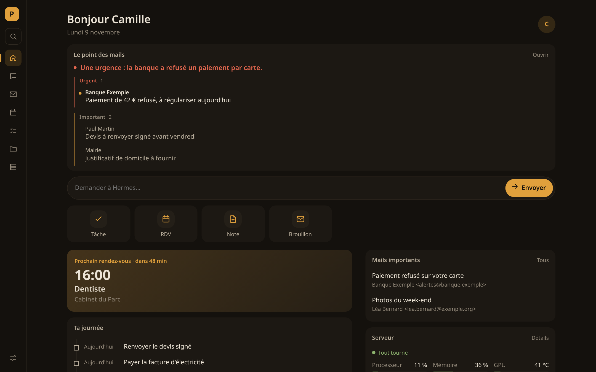
  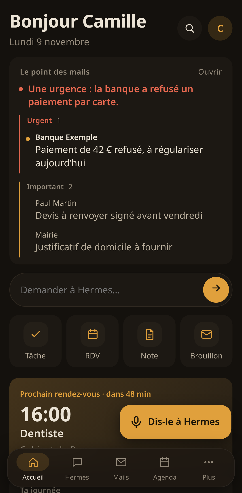
</p>

---

Poste tourne sur ton serveur. Il garde tes données dans un seul fichier SQLite et se branche sur les services que tu utilises déjà : n'importe quelle boîte IMAP, Google Agenda, iCloud, Nextcloud, et l'IA de ton choix (Ollama, LM Studio, vLLM, OpenAI…). Tout fonctionne sans IA ; avec elle, Poste fait chaque matin le point de tes mails et te prépare des brouillons de réponse.

> **Poste n'envoie jamais de mail.** Il lit et prépare des brouillons ; tu les relis et tu les envoies depuis ta messagerie. Aucune route d'envoi n'existe, et un test le vérifie.

## Sommaire

- [Fonctions](#fonctions)
- [Démarrage rapide avec Docker](#démarrage-rapide-avec-docker)
- [Installation sans Docker](#installation-sans-docker)
- [Ouvrir Poste depuis ton téléphone](#ouvrir-poste-depuis-ton-téléphone)
- [Brancher tes services](#brancher-tes-services)
- [Modules](#modules)
- [Sauvegardes](#sauvegardes)
- [Sécurité](#sécurité)
- [Référence des réglages](#référence-des-réglages)
- [Développement](#développement)
- [Feuille de route](#feuille-de-route)
- [Licence](#licence)

## Fonctions

### Accueil

Une page pour la journée : le point des mails du matin, une zone pour poser une question à l'assistant, des actions rapides (tâche, rendez-vous, note, brouillon), ton prochain rendez-vous avec le temps restant, le fil de la journée (rendez-vous et tâches du jour autour d'un repère « maintenant »), les mails importants non lus, l'état de ton serveur et le journal de tout ce qui s'est passé.

### Mails

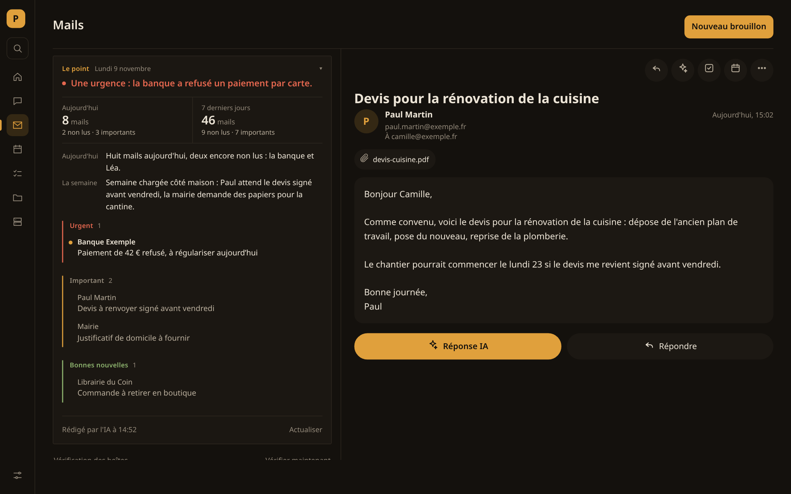

- **Toutes tes boîtes IMAP dans une seule liste** : Gmail, iCloud, Fastmail, Infomaniak, OVHcloud, ou n'importe quel serveur IMAP. Un nouveau mail apparaît en quelques secondes (IMAP IDLE), avec une synchronisation régulière en secours.
- **Lecture sans effet de bord** : Poste ne marque jamais un mail comme lu sur le serveur.
- **Mails HTML sans danger** : nettoyés, puis affichés dans un cadre isolé, sans script ni formulaire. Les images distantes restent bloquées tant que tu ne les demandes pas, et toujours pour un mail suspect.
- **Alertes d'hameçonnage et de spam** : chaque mail reçoit une note, avec les raisons expliquées (domaine qui imite un autre, lien trompeur, pièce jointe dangereuse…). Poste prévient, il ne décide jamais à ta place.
- **Mails importants** : ce qu'une personne t'a écrit est distingué des lettres d'information et des notifications.
- **« Le point », le résumé du jour** : l'IA écrit une vingtaine de lignes sur la journée et la semaine. Elle dit s'il y a une urgence, puis cite les mails importants, les bonnes et les mauvaises nouvelles. Les chiffres sont comptés par Poste, jamais par l'IA. Chaque matin, à l'heure choisie, le point arrive aussi sur ton téléphone et en haut de l'accueil, en petit, moyen ou grand format.
- **Brouillons de réponse par l'IA** : tu donnes le thème en quelques mots, l'IA rédige dans la langue du mail, tu relis, et le brouillon se range dans le dossier Brouillons de ta boîte.
- **Mail → tâche ou rendez-vous** : l'IA remplit le formulaire à partir du mail ; tu vérifies et tu valides.
- **Bloquer un expéditeur** : ses mails vont dans le Spam, jamais supprimés. En option, le blocage est aussi posé sur ton serveur de mail (Mailcow).

### Agenda

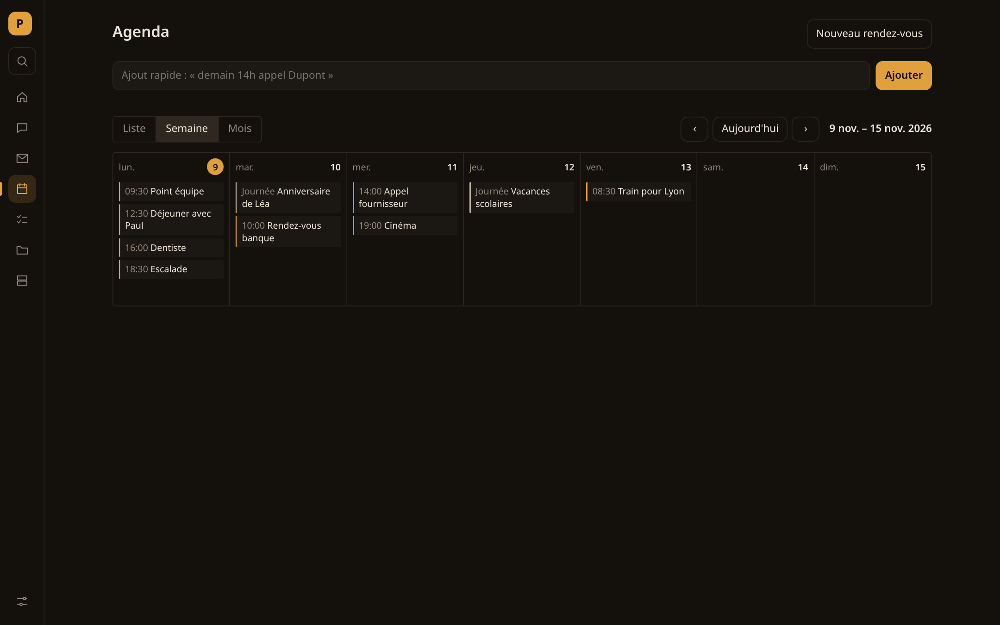

- Vues liste, semaine et mois, rappels.
- **Ajout rapide en français** : « demain 14h dentiste ».
- **Agendas externes, en lecture seule** : Google Agenda et Outlook (lien iCal secret), iCloud, Nextcloud et Fastmail (CalDAV), ou n'importe quel flux `.ics` / `webcal://`. Recopiés tous les quarts d'heure, d'un mois en arrière à un an en avant.

### Tâches

<p align="center">
  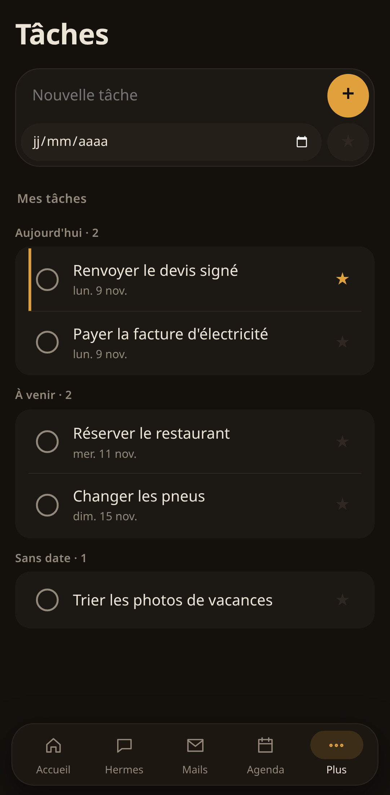
  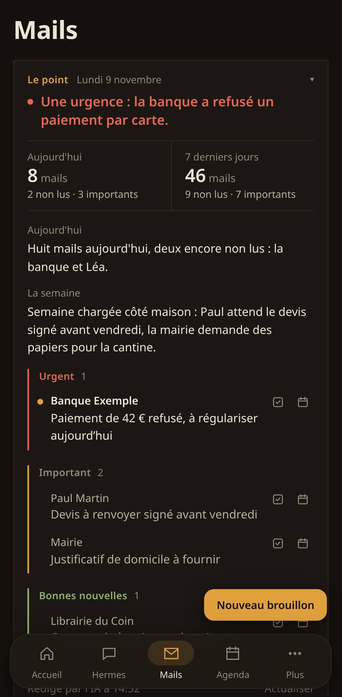
  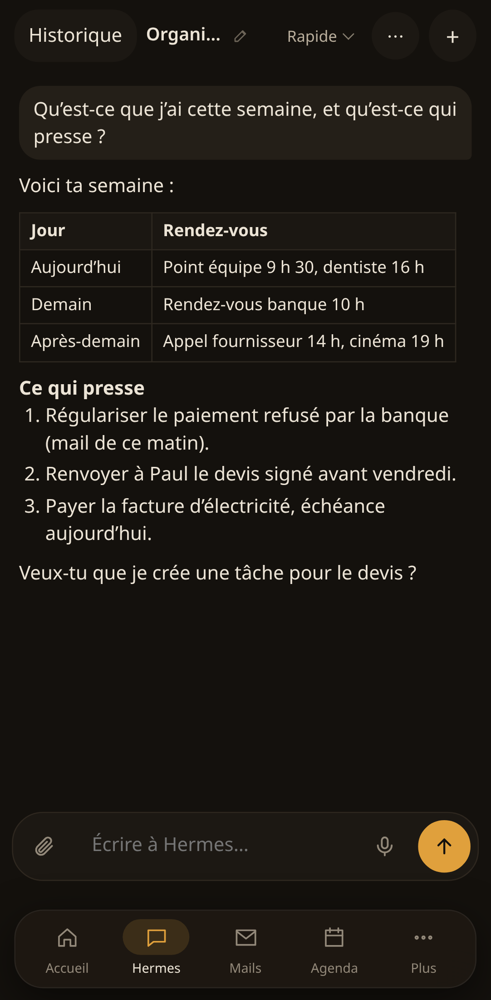
</p>

Priorités, échéances, groupes (en retard, aujourd'hui, à venir, sans date) et gestes au doigt sur téléphone : glisser à droite termine, glisser à gauche retire. Une notification arrive le matin de l'échéance.

### Fichiers

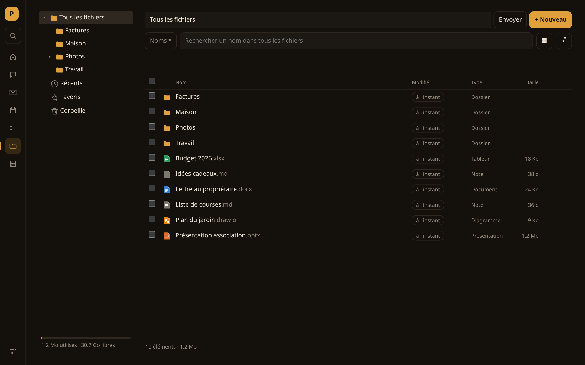

- Un espace de fichiers sur ton serveur : arborescence, récents, favoris et corbeille d'où l'on restaure.
- **Recherche en trois modes** : la vue en cours, les noms partout, ou le **contenu** partout, avec les extraits surlignés. Word, Excel, PowerPoint et PDF sont indexés en tâche de fond.
- Aperçu des images, PDF et Markdown, et une visionneuse d'images (galerie, diaporama, zoom, rotation).
- Sélection multiple, déplacement, copie, **archive zip**, envois avec progression.
- Un **éditeur de notes** aidé par l'IA : Tab accepte la suite proposée, correction de l'orthographe, réécriture sur demande. Chaque changement est montré en différences avant que tu l'acceptes.
- **Ranger avec l'IA** : l'IA propose un plan de dossiers, et rien ne bouge avant ton accord.
- **Masquer un document** : les données personnelles (noms, adresses mail, numéros de téléphone, IBAN…) sont cachées dans une copie, relue entièrement avant d'être livrée. L'original ne change pas.
- Conversion en PDF. En option : **Word, Excel et PowerPoint dans le navigateur** (Collabora Online, thème sombre, son assistant IA branché sur ton IA) et **diagrammes** (draw.io).

### Assistant (Hermes)

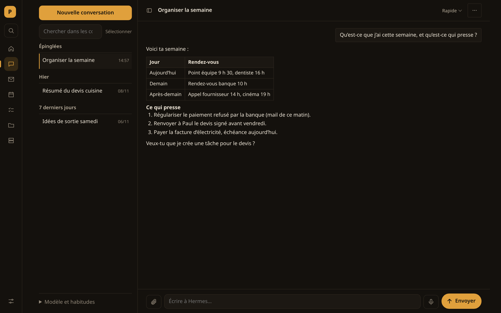

Une interface de discussion, en option, pour [Hermes Agent](https://github.com/NousResearch/hermes-agent), un agent IA open source que tu fais tourner toi-même :

- Réponses en direct mises en forme (tableaux, listes, code), historique avec recherche, épingles, renommage et sélection multiple.
- **Accord humain** : toute action autre qu'une lecture attend ta confirmation, à l'écran ou par une notification sur le téléphone. « Toujours autoriser » n'existe que pour les actions simples et non sensibles.
- **Pièces jointes** : documents (PDF, bureautique, scans lus par OCR, audio transcrit), photos (envoyées en image à un modèle qui voit, sinon lues par OCR) et fichiers choisis dans ton espace Fichiers.
- **Livrables** : les fichiers créés par l'assistant apparaissent en cartes sous la réponse, avec un panneau d'aperçu (pages Office, PDF, Markdown, CSV, HTML dans un cadre fermé).
- **Choix du modèle** dans l'en-tête de la discussion, quand ton moteur d'IA en propose plusieurs.

### Serveur

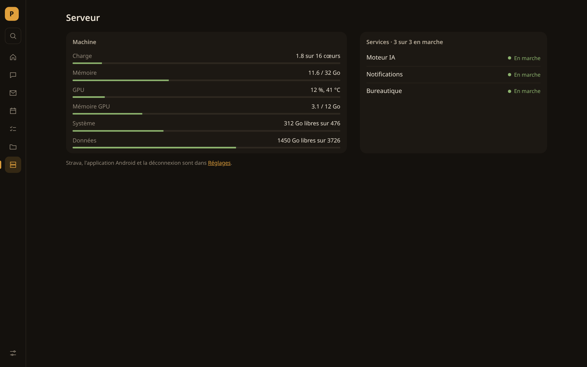

Charge du processeur, mémoire, carte graphique NVIDIA (charge, mémoire, température), disques et services systemd. Une alerte part quand un service s'arrête, qu'un disque se remplit ou que la carte graphique chauffe, une seule fois et pas en boucle.

### Sites intégrés

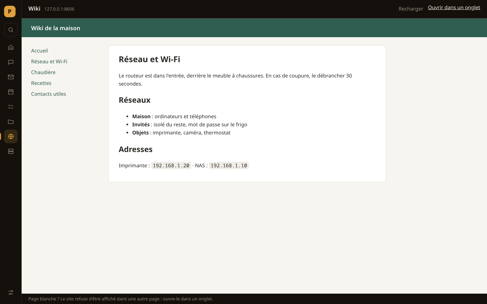

Ajoute les applications web que tu utilises déjà (CRM, wiki, supervision, domotique…) dans **Réglages → Sites intégrés**. Chacune a son entrée dans le menu et s'ouvre dans Poste. Un site qui refuse d'être affiché dans un cadre propose de s'ouvrir dans un onglet.

### Partout

- **Recherche globale** (`Ctrl K`) : sections, tâches, rendez-vous, fichiers (noms et contenu), mails et conversations de l'assistant, dans une seule fenêtre.
- **Sur téléphone** : une vraie interface mobile (navigation au pouce, feuilles, tirer pour actualiser), installable sur l'écran d'accueil. Une application Android en option ajoute les notifications natives sans services Google et gère la touche Retour.
- **Notifications** par [ntfy](https://ntfy.sh), chaque type se coupe à part : mails importants, assistant en attente ou terminé, rappels, tâches, alertes serveur, sauvegardes en échec.
- **Dictée** : un micro à côté de chaque champ, avec transcription en direct, si tu as un service de transcription (Speaches, whisper.cpp…). Le son va à ce service et nulle part ailleurs.
- **Mises à jour** : les pages ouvertes se rechargent seules quand Poste est mis à jour, jamais pendant une saisie.

## Démarrage rapide avec Docker

Il faut Docker (ou Podman) avec Compose.

```bash
git clone https://github.com/Dimitri-Rey/POSTE.git poste && cd poste
cp .env.example .env
mkdir -p config
docker compose up -d
```

Ouvre <http://localhost:8541> : Poste te demande de choisir un mot de passe (10 caractères minimum). Le reste se règle dans **Réglages**.

Services en option, dans le même fichier :

```bash
docker compose --profile ntfy up -d      # notifications sur le téléphone, port 8546
docker compose --profile drawio up -d    # éditeur de diagrammes, port 8543
```

Le conteneur tourne avec l'utilisateur `1000`, qui doit pouvoir écrire dans `./config`. Si ton identifiant d'utilisateur n'est pas 1000 : `sudo chown 1000:1000 config`. Avec **Podman sans root**, décommente `userns_mode: keep-id` dans `compose.yaml`.

Les données vivent dans le volume `poste-donnees` (base, fichiers), et les réglages dans `./config`, dont la clé qui chiffre tes mots de passe enregistrés. **Sauvegarde ce dossier** : sans lui, les mots de passe enregistrés sont à ressaisir.

## Installation sans Docker

Python 3.12 ou plus récent.

```bash
python3 -m venv .venv && .venv/bin/pip install -r requirements.txt
mkdir -p ~/.config/poste && cp poste.exemple.toml ~/.config/poste/poste.toml   # facultatif
.venv/bin/uvicorn poste.app:creer --factory --app-dir api --host 127.0.0.1 --port 8541
```

Pour le garder allumé, un service systemd utilisateur suffit (`~/.config/systemd/user/poste.service`) :

```ini
[Unit]
Description=Poste
After=network-online.target

[Service]
WorkingDirectory=%h/poste/api
ExecStart=%h/poste/.venv/bin/uvicorn poste.app:creer --factory --host 127.0.0.1 --port 8541 --no-server-header
Restart=on-failure
UMask=0077

[Install]
WantedBy=default.target
```

Puis `systemctl --user enable --now poste`, et `loginctl enable-linger` pour qu'il démarre sans session ouverte. Sans Docker, la page Serveur suit aussi tes services systemd (section `[serveur.services]` de `poste.toml`).

Outils facultatifs, utilisés s'ils sont installés : `rclone` (sauvegardes vers les clouds), `libreoffice` (aperçus et conversions Office), `poppler-utils` (pages des PDF), `tesseract` (OCR), `pandoc`. L'image Docker contient rclone.

## Ouvrir Poste depuis ton téléphone

Poste n'est pas fait pour être exposé tel quel sur Internet. Passe par un accès HTTPS privé :

- **Tailscale** (le plus simple) : `tailscale serve --bg --https=443 http://127.0.0.1:8541`. Poste est alors à `https://<machine>.<tailnet>.ts.net`.
- **Un proxy inverse** (Caddy, Traefik, nginx) avec un certificat, de préférence derrière un VPN ou une authentification en plus.

Ajoute ensuite l'adresse dans `.env` (`POSTE_HOTES` et `POSTE_ORIGINES`) et redémarre. Poste refuse les noms d'hôte et les origines qu'il ne connaît pas.

Sur le téléphone, ouvre cette adresse puis « Ajouter à l'écran d'accueil » : Poste s'ouvre alors en plein écran, comme une application. Une enveloppe Android (Capacitor) est aussi fournie dans `android/`. `deploiement/construire-apk.sh` construit un APK signé qui ouvre ton adresse (`adresse_publique` de `poste.toml`) ; il faut le JDK 21 et le SDK Android.

## Brancher tes services

Tout se fait dans **Réglages**. Poste essaie chaque branchement avant de l'enregistrer et te dit ce qui coince.

### Boîtes mail

Choisis ton fournisseur, puis donne l'adresse et un **mot de passe d'application** : la plupart des fournisseurs refusent le mot de passe habituel pour IMAP.

| Fournisseur | Où créer le mot de passe |
|---|---|
| Gmail | validation en deux étapes activée, puis myaccount.google.com/apppasswords |
| iCloud | account.apple.com → Connexion et sécurité → Mots de passe pour app |
| Fastmail | Réglages → Confidentialité et sécurité → Mots de passe d'application (accès IMAP) |
| Infomaniak, OVHcloud | le mot de passe de la boîte suffit en général |
| Outlook, Hotmail | Microsoft impose maintenant OAuth pour la plupart des comptes, que Poste ne gère pas encore |

### Agendas

- **Google Agenda** : sur ordinateur, Paramètres → ton agenda → « Adresse secrète au format iCal ».
- **Outlook** : Paramètres → Calendrier → Calendriers partagés → « Publier un calendrier » → lien ICS.
- **iCloud** : CalDAV, `https://caldav.icloud.com`, avec un mot de passe pour app.
- **Nextcloud** : CalDAV, `https://ton-serveur/remote.php/dav`, avec un mot de passe d'application.
- **Fastmail** : CalDAV, `https://caldav.fastmail.com/dav/`.
- N'importe quel lien `.ics` ou `webcal://` (vacances scolaires, calendrier sportif…).

### Intelligence artificielle

N'importe quel service compatible OpenAI : [Ollama](https://ollama.com) (`http://host.docker.internal:11434` depuis Docker, `http://127.0.0.1:11434` sinon), LM Studio, vLLM, llama.cpp, LiteLLM, ou OpenAI avec une clé d'API. Depuis Docker, le service doit écouter au-delà de `127.0.0.1` (pour Ollama : `OLLAMA_HOST=0.0.0.0`). Elle sert au point des mails, aux brouillons de réponse, au passage d'un mail en tâche, à l'aide dans les notes et au rangement des fichiers.

### Dictée

Un service de transcription qui parle l'API OpenAI `/v1/audio/transcriptions`, par exemple [Speaches](https://github.com/speaches-ai/speaches) ou le serveur de whisper.cpp.

### Notifications

Installe l'application ntfy sur ton téléphone et choisis un sujet dans Réglages. Sur ntfy.sh, un sujet est public : prends un nom difficile à deviner, ou utilise ton propre serveur avec le profil `ntfy` et un jeton. Abonne-toi ensuite au même sujet dans l'application. « Enregistrer et envoyer un essai » vérifie toute la chaîne.

### Sites intégrés

Réglages → Sites intégrés → « + Ajouter » : un nom et une adresse (`http://` ou `https://`). L'origine du site est ajoutée à la politique de sécurité de Poste tant que le site est là.

## Modules

Chaque module se coupe dans Réglages (ou dans `poste.toml`). Coupé, il disparaît du menu et de l'accueil, et ses routes répondent 404.

| Module | Par défaut | Il faut |
|---|---|---|
| Mails, Agenda, Tâches, Fichiers, Serveur | actifs | — |
| Hermes (assistant) | coupé | une passerelle [Hermes Agent](https://github.com/NousResearch/hermes-agent) (section `[hermes]`) |
| Dictée | coupé | un service de transcription compatible OpenAI |
| Notifications | coupé | un serveur ntfy (ntfy.sh ou le tien) |
| Collabora (Word, Excel, PowerPoint) | coupé | Collabora Online (section `[collabora]`) |
| draw.io (diagrammes) | coupé | le profil Compose `drawio`, ou ton propre draw.io |
| Sport | coupé | une application d'API Strava (lecture seule) |
| Blocage Mailcow | coupé | un serveur Mailcow et une clé d'API |

## Sauvegardes

Réglages → Sauvegardes → « Ajouter un endroit », puis le stockage :

| Stockage | Par | Ce qu'il faut |
|---|---|---|
| Disque externe, NAS déjà monté | dossier du serveur | son chemin (`/mnt/disque`) |
| NAS Synology | SMB (ou SFTP, WebDAV) | adresse, dossier partagé, compte DSM ou compte d'annuaire (LDAP/AD, avec le domaine) |
| Partage Windows, Samba, Active Directory | SMB (NTLM, ou Kerberos si le serveur a un ticket) | serveur, partage, compte, domaine |
| Google Drive, Dropbox | jeton OAuth | `rclone authorize "drive"` (ou `"dropbox"`) sur un ordinateur avec navigateur, puis coller le résultat |
| kDrive (Infomaniak) | WebDAV | `https://<numéro>.connect.kdrive.infomaniak.com`, e-mail, mot de passe (d'application) |
| Nextcloud, ownCloud | WebDAV | `https://serveur/remote.php/dav/files/<identifiant>`, mot de passe d'application |
| Autre WebDAV, SFTP, FTP(S) | — | adresse, compte, mot de passe ou clé privée |
| S3 (Amazon, Backblaze, Wasabi, OVHcloud, Scaleway, MinIO, Synology C2…) | S3 | endpoint, compartiment existant, clés d'accès |
| OneDrive, SharePoint, pCloud, Mega, Proton Drive, Azure… | configuration rclone | la section du stockage dans `rclone.conf`, créée par `rclone config` |

Tout sauf le dossier local passe par [rclone](https://rclone.org). Poste le configure à chaque appel par variables d'environnement : aucun fichier de configuration écrit, mots de passe et jetons gardés chiffrés dans le coffre de Poste. La connexion est essayée (écriture, relecture, effacement d'un fichier d'essai) avant d'enregistrer.

- **Chiffrement** : avec un mot de passe de chiffrement, les sauvegardes sont chiffrées avant de partir, noms de fichiers compris (rclone crypt) ; le fournisseur ne voit rien. Garde ce mot de passe ailleurs : sans lui, elles sont illisibles.
- **Planning et rotation** : l'heure, les jours (ou un jour par mois), quand faire une sauvegarde **complète** (chaque semaine, chaque mois ou à chaque fois ; les autres fois elle est **incrémentielle**) et combien de complètes garder avec leurs incrémentielles. Un échec envoie une notification.
- **Ce qui est copié** : la base (copie cohérente pendant que Poste tourne), les Fichiers, les documents joints, les créations et `poste.toml` ; les clés et secrets seulement si l'interrupteur est mis.
- **Récupérer des fichiers** : Historique → « Récupérer les fichiers » remet les Fichiers tels qu'à cette date dans Fichiers › Restaurations, sans rien écraser.
- **Tout restaurer** (après une panne) : arrête Poste, puis rassemble la chaîne dans un dossier vide. Depuis `api/`, avec l'environnement de Poste :

```bash
# Endroit réglé dans Poste (numéro affiché au survol de « Modifier ») : clouds et NAS compris, déchiffrement compris
python -m poste.modules.sauvegardes 2                       # liste des sauvegardes
python -m poste.modules.sauvegardes 2 poste-20261105-030000-incr.tar.gz /tmp/restauration
# Dossier local, ou dossier recopié depuis le stockage
python -m poste.modules.sauvegardes /mnt/disque/poste-sauvegardes poste-20261105-030000-incr.tar.gz /tmp/restauration
```

Remets ensuite `donnees/poste.db` à la place de la base (`~/.local/share/poste/poste.db`, ou `/data/poste.db` en Docker), avec `donnees/espace`, `donnees/documents` et `donnees/fichiers` à côté. Place `config/poste.toml` dans `~/.config/poste/` (et `config/secrets/*` s'ils ont été copiés), puis relance Poste.

## Sécurité

- Un seul utilisateur, un mot de passe (haché avec scrypt). Les sessions passent par un cookie `HttpOnly`, `SameSite=Strict`, `Secure`, et les essais de mot de passe sont freinés.
- Noms d'hôte et origines contrôlés (contre le rebinding DNS et les requêtes d'autres sites), politique de sécurité du contenu stricte.
- Mots de passe des boîtes et des agendas, clés d'API et jetons : chiffrés dans la base, avec une clé rangée à part (`config/cle-secrets`). Aucune route ne les renvoie.
- Mails HTML nettoyés, puis affichés dans un cadre sans script ni formulaire.
- Un fichier reçu est hostile par principe : l'extraction du texte tourne dans un dossier jetable, avec temps et mémoire limités, et rien n'est exécuté.
- L'assistant ne joint Poste que par un jeton local limité à une liste de routes. Il ne peut jamais valider ses propres actions, changer de modèle ni toucher aux réglages.

Une faille ? Signale-la en privé (voir [SECURITY.md](SECURITY.md)) plutôt que dans un ticket public.

## Référence des réglages

Toutes les options de `poste.toml`, les variables d'environnement et les ports par défaut sont décrits dans **[docs/CONFIGURATION.fr.md](docs/CONFIGURATION.fr.md)**. Le modèle commenté est [`poste.exemple.toml`](poste.exemple.toml).

## Développement

```bash
.venv/bin/python -m pytest -q tests          # API (environ 230 tests)
PLAYWRIGHT=<chemin de playwright-core> CHROME=<chemin de chromium> node tests/sites.cjs <dossier-captures>   # un parcours navigateur
PLAYWRIGHT=… CHROME=… node tests/captures-readme.cjs docs/captures                                          # captures du README, données fictives
```

Les tests utilisent leurs propres réglages (`tests/reglages-test.toml`) et ne touchent jamais à ceux de la machine. L'interface est en JavaScript sans framework ni étape de construction (modules ES, `web/`). L'API est en FastAPI (`api/poste/`). Les données sont dans SQLite, et les tâches de fond tournent dans le même processus.

```
api/poste/          application FastAPI, un module par fonction (mails, agenda, espace, hermes, sauvegardes…)
web/                interface : index.html, style.css, js/ (code commun), vues/ (un fichier par écran)
android/            enveloppe Capacitor et service de notifications natif
tests/              pytest (API) et parcours Playwright (*.cjs)
docs/               captures et référence des réglages
```

## Feuille de route

Des idées et des améliorations prévues, sans engagement de date :

- **Interface en anglais**, et un système de traduction pour d'autres langues.
- **Outils de l'assistant** : publier le plugin Hermes qui permet à l'assistant de lire mails, agenda, tâches et fichiers, et qui impose l'accord humain.
- **Connexion OAuth** pour Microsoft 365 / Outlook.com et Gmail, sans mot de passe d'application.
- **Agendas en écriture** (CalDAV) et **contacts** (CardDAV).
- **Image Docker prête à l'emploi** sur GitHub Container Registry, et APK joints aux versions.
- **Clés d'accès** (passkeys, WebAuthn) pour se connecter.
- **Thème clair**.
- **Restaurer une sauvegarde** depuis l'interface, pas seulement en ligne de commande.
- **Sites intégrés** : icônes, ordre et dossiers.

Les suggestions sont les bienvenues dans les tickets.

## Licence

[GNU AGPL-3.0](LICENSE). Tu peux utiliser, modifier et redistribuer Poste. Si tu le proposes à d'autres sur un réseau, tu dois leur donner accès au code source de ta version.
