<p align="center">
  
</p>

<h1 align="center">Poste</h1>

<p align="center">
  <strong>Your workspace, at home.</strong><br>
  Mail, calendar, tasks, files, an AI assistant and your server, in one interface, on desktop and phone.
</p>

<p align="center">
  <a href="LICENSE"></a>
  
  
  
  
</p>

<p align="center">
  <b>English</b> · <a href="README.fr.md">Français</a>
</p>

<p align="center">
  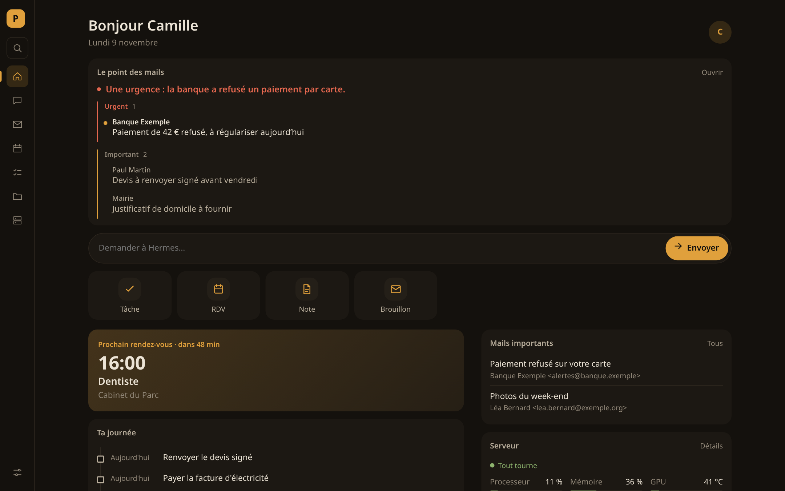
  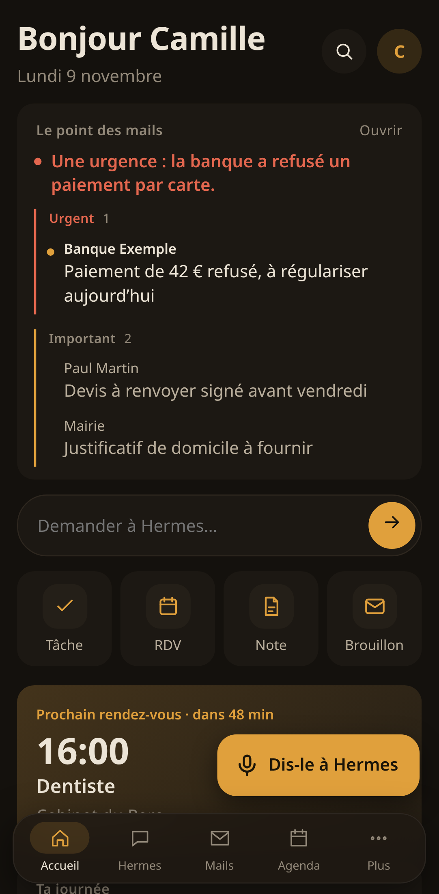
</p>

---

Poste runs on your own server. It keeps your data in a single SQLite file and plugs into the services you already use: any IMAP mailbox, Google Calendar, iCloud, Nextcloud, and the AI of your choice (Ollama, LM Studio, vLLM, OpenAI…). Everything works without AI; with it, Poste summarises your mail every morning and drafts replies for you.

> **Poste never sends an email.** It reads and prepares drafts; you review and send them from your usual mail app. There is no sending route at all, and a test checks it.

> **Interface language:** the interface is in French for now. An English interface is on the [roadmap](#roadmap).

## Contents

- [Features](#features)
- [Quick start with Docker](#quick-start-with-docker)
- [Install without Docker](#install-without-docker)
- [Open Poste from your phone](#open-poste-from-your-phone)
- [Connect your services](#connect-your-services)
- [Modules](#modules)
- [Backups](#backups)
- [Security](#security)
- [Configuration reference](#configuration-reference)
- [Development](#development)
- [Roadmap](#roadmap)
- [License](#license)

## Features

### Home

One page for the day: the morning mail summary, a box to ask the assistant, quick actions (task, appointment, note, draft), your next appointment with a countdown, today's timeline (appointments and due tasks around a "now" marker), important unread mail, the state of your server, and a log of everything that happened.

### Mail

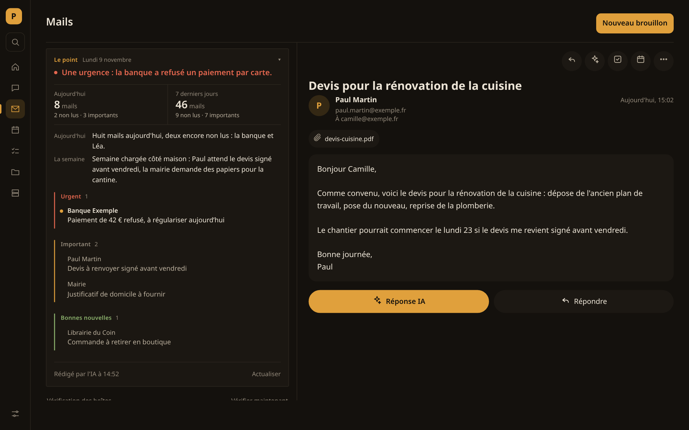

- **All your IMAP mailboxes in one list**: Gmail, iCloud, Fastmail, Infomaniak, OVHcloud, or any IMAP server. New mail shows up within seconds (IMAP IDLE), with a regular sync as a safety net.
- **Read without side effects**: Poste never marks a message as read on the server.
- **Safe HTML mail**: messages are cleaned, then shown in an isolated frame with no scripts or forms. Remote images stay blocked until you ask for them, and are always blocked for suspicious mail.
- **Phishing and spam warnings**: each message gets a score, with the reasons explained (look-alike domains, mismatched links, dangerous attachments…). Poste warns; it never decides for you.
- **Important mail**: messages written to you by a person are told apart from newsletters and notifications.
- **"Le point", the daily summary**: the AI writes about twenty lines on today and the week. It says whether anything is urgent, then lists important mail, good news and bad news. The counts are computed by Poste, never by the AI. Every morning, at the time you choose, the summary also reaches your phone and the top of the home page, in small, medium or large format.
- **AI reply drafts**: describe the reply in a few words, and the AI writes it in the language of the message. You review it, and it lands in your mailbox's Drafts folder.
- **Mail → task or appointment**: the AI fills in the form from the message; you check and confirm.
- **Block a sender**: their mail goes to Spam and is never deleted. Optionally, the block is also set on your mail server (Mailcow).

### Calendar

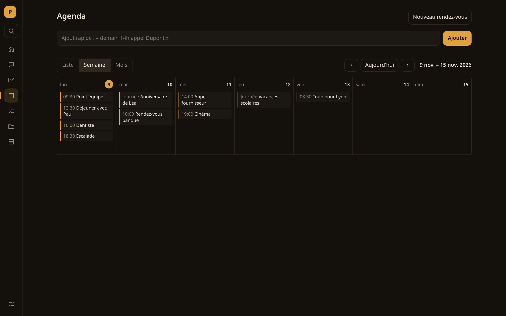

- List, week and month views, with reminders.
- **Quick add in plain French**: « demain 14h dentiste » ("tomorrow 2pm dentist").
- **External calendars, read-only**: Google Calendar and Outlook (secret iCal link), iCloud, Nextcloud and Fastmail (CalDAV), or any `.ics` / `webcal://` feed. They are refreshed every 15 minutes, from one month back to one year ahead.

### Tasks

<p align="center">
  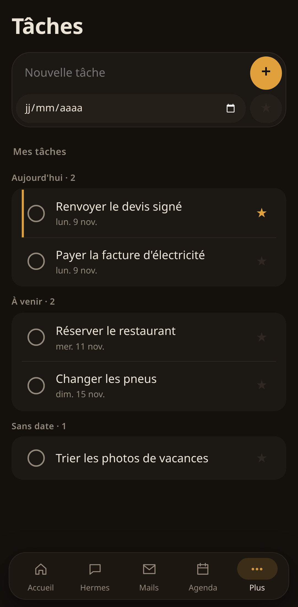
  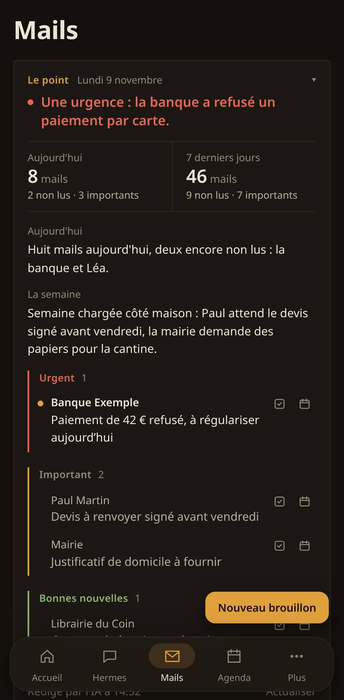
  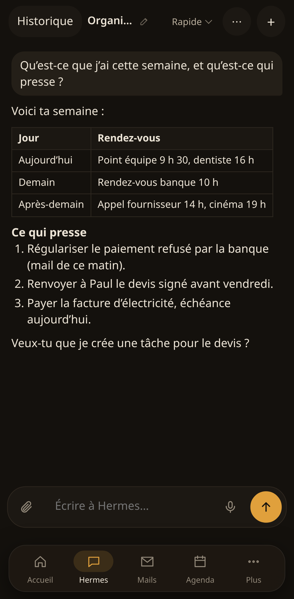
</p>

Priorities, due dates, groups (late, today, upcoming, no date), and finger gestures on the phone: swipe right to complete, swipe left to remove. A notification arrives on the morning a task is due.

### Files

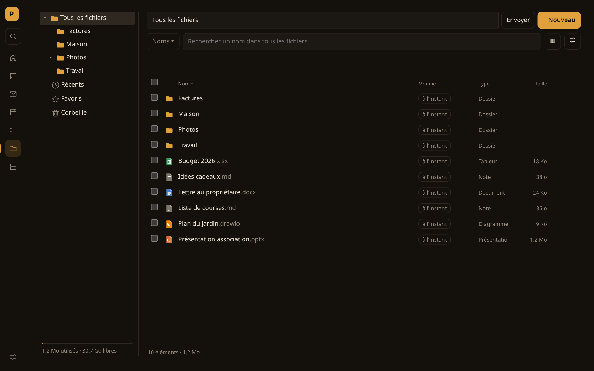

- A file space on your server, with a folder tree, recent files, favourites and a trash you can restore from.
- **Search in three modes**: the current view, names everywhere, or **content** everywhere, with highlighted excerpts. Word, Excel, PowerPoint and PDF files are indexed in the background.
- Previews of images, PDF and Markdown, and an image viewer with gallery, slideshow, zoom and rotation.
- Multiple selection, move, copy, **zip archive**, uploads with progress.
- A **note editor** with AI help: press Tab to accept a suggested continuation, fix spelling, or rewrite on request. Every change is shown as a diff before you accept it.
- **Tidy with AI**: the AI proposes a folder plan, and nothing moves until you approve it.
- **Redact a document**: personal data (names, e-mail addresses, phone numbers, IBANs…) is hidden in a copy, and the copy is checked in full before it is delivered. The original is untouched.
- Conversion to PDF. Optional: **Word, Excel and PowerPoint in the browser** (Collabora Online, dark theme, with its AI assistant wired to your AI) and **diagrams** (draw.io).

### Assistant (Hermes)

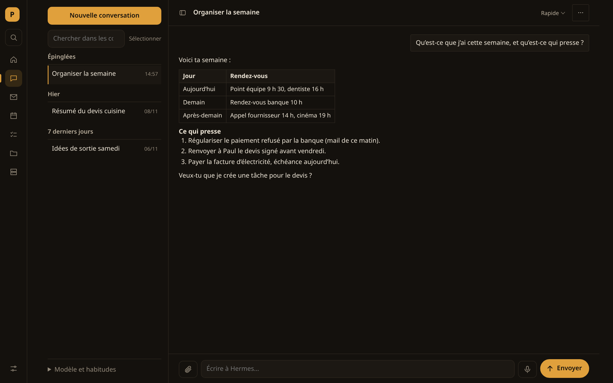

An optional chat interface for [Hermes Agent](https://github.com/NousResearch/hermes-agent), an open-source AI agent you run yourself:

- Streaming answers rendered as Markdown (tables, lists, code), conversation history with search, pinning and renaming, and multiple selection.
- **Human approval**: every action other than reading waits for your confirmation, on screen or through a phone notification. "Always allow" exists only for simple, non-sensitive actions.
- **Attachments**: documents (PDF, Office, scans read by OCR, audio transcribed), photos (sent as images to a vision model, otherwise read by OCR), and files picked from your Files space.
- **Deliverables**: files created by the assistant appear as cards under the answer, with a preview panel (Office pages, PDF, Markdown, CSV, HTML in a sealed frame).
- **Model switch** in the chat header, when your AI engine offers several models.

### Server

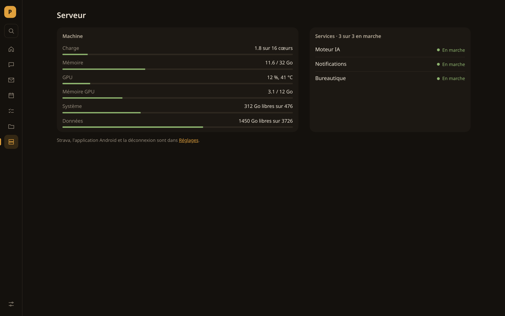

CPU load, memory, NVIDIA GPU (load, memory, temperature), disks and systemd services. Alerts are raised when a service stops, a disk fills up or the GPU runs hot. Each alert fires once, not again and again.

### Embedded sites

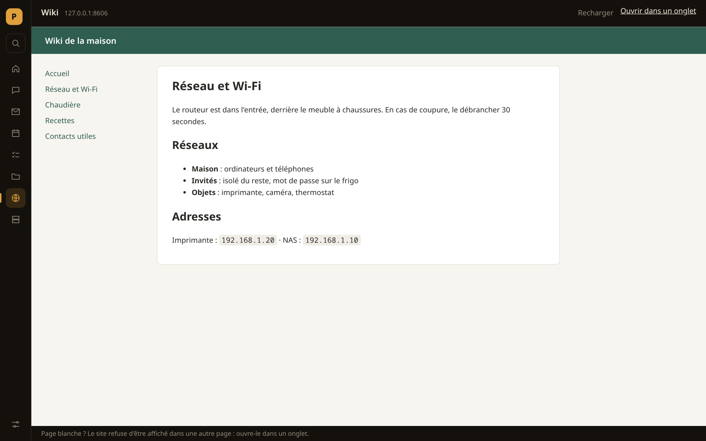

Add the web apps you already use (CRM, wiki, monitoring, home automation…) in **Settings → Sites intégrés**. Each one gets its own entry in the menu and opens inside Poste. A site that refuses to be shown in a frame offers to open in a new tab instead.

### Everywhere

- **Global search** (`Ctrl K`): sections, tasks, appointments, files (names and content), mail and assistant conversations, in one window.
- **On the phone**: a real mobile interface (thumb navigation, bottom sheets, pull to refresh), installable on the home screen. An optional Android app adds native notifications without Google services, and handles the Back button.
- **Notifications** through [ntfy](https://ntfy.sh), each type switchable: important mail, assistant waiting or done, reminders, tasks, server alerts, failed backups.
- **Voice dictation**: a microphone next to every text field, with live transcription, if you run a transcription service (Speaches, whisper.cpp…). Audio goes to that service and nowhere else.
- **Updates**: open pages reload by themselves when Poste is updated, but never while you are typing.

## Quick start with Docker

You need Docker (or Podman) with Compose.

```bash
git clone https://github.com/Dimitri-Rey/POSTE.git poste && cd poste
cp .env.example .env
mkdir -p config
docker compose up -d
```

Open <http://localhost:8541>. Poste asks you to choose a password (10 characters minimum); everything else is set up in **Réglages** (Settings).

Optional services in the same file:

```bash
docker compose --profile ntfy up -d      # phone notifications, port 8546
docker compose --profile drawio up -d    # diagram editor, port 8543
```

The container runs as user `1000`, which must be able to write to `./config`. If your user ID is not 1000, run `sudo chown 1000:1000 config`. With **rootless Podman**, uncomment `userns_mode: keep-id` in `compose.yaml`.

Data lives in the `poste-donnees` volume (database, files). Settings live in `./config`, including the key that encrypts your saved passwords. **Back this folder up**: without it, saved passwords have to be entered again.

## Install without Docker

Python 3.12 or newer.

```bash
python3 -m venv .venv && .venv/bin/pip install -r requirements.txt
mkdir -p ~/.config/poste && cp poste.exemple.toml ~/.config/poste/poste.toml   # optional
.venv/bin/uvicorn poste.app:creer --factory --app-dir api --host 127.0.0.1 --port 8541
```

To keep it running, a systemd user service is enough (`~/.config/systemd/user/poste.service`):

```ini
[Unit]
Description=Poste
After=network-online.target

[Service]
WorkingDirectory=%h/poste/api
ExecStart=%h/poste/.venv/bin/uvicorn poste.app:creer --factory --host 127.0.0.1 --port 8541 --no-server-header
Restart=on-failure
UMask=0077

[Install]
WantedBy=default.target
```

Then run `systemctl --user enable --now poste`, and `loginctl enable-linger` so that it starts without an open session. Without Docker, the Server page can also follow your systemd services (`[serveur.services]` in `poste.toml`).

Optional tools that Poste uses when they are installed: `rclone` (cloud backups), `libreoffice` (Office previews and conversions), `poppler-utils` (PDF pages), `tesseract` (OCR), `pandoc`. The Docker image includes rclone.

## Open Poste from your phone

Poste is not meant to face the Internet directly. Reach it over HTTPS through a private network:

- **Tailscale** (the simplest): `tailscale serve --bg --https=443 http://127.0.0.1:8541`. Poste is then at `https://<machine>.<tailnet>.ts.net`.
- **A reverse proxy** (Caddy, Traefik, nginx) with a certificate, preferably behind a VPN or extra authentication.

Then add the address to `.env` (`POSTE_HOTES` and `POSTE_ORIGINES`) and restart. Poste rejects host names and origins it does not know.

On the phone, open that address and choose "Add to Home screen": Poste then opens full screen, like an app. An Android wrapper (Capacitor) is also provided in `android/`. `deploiement/construire-apk.sh` builds a signed APK that opens your address (`adresse_publique` in `poste.toml`); it needs JDK 21 and the Android SDK.

## Connect your services

Everything is done in **Réglages** (Settings). Poste tests each connection before saving it and tells you what is wrong.

### Mailboxes

Choose your provider, then give the address and an **app password**: most providers refuse your usual password for IMAP.

| Provider | Where to create the app password |
|---|---|
| Gmail | turn on 2-Step Verification, then myaccount.google.com/apppasswords |
| iCloud | account.apple.com → Sign-In and Security → App-Specific Passwords |
| Fastmail | Settings → Privacy & Security → App passwords (IMAP access) |
| Infomaniak, OVHcloud | the mailbox password usually works |
| Outlook, Hotmail | Microsoft now requires OAuth for most accounts, which Poste does not support yet |

### Calendars

- **Google Calendar**: on a computer, Settings → your calendar → "Secret address in iCal format".
- **Outlook**: Settings → Calendar → Shared calendars → "Publish a calendar" → ICS link.
- **iCloud**: CalDAV, `https://caldav.icloud.com`, with an app-specific password.
- **Nextcloud**: CalDAV, `https://your-server/remote.php/dav`, with an app password.
- **Fastmail**: CalDAV, `https://caldav.fastmail.com/dav/`.
- Any `.ics` or `webcal://` link (school holidays, sports fixtures…).

### Artificial intelligence

Any OpenAI-compatible service: [Ollama](https://ollama.com) (`http://host.docker.internal:11434` from Docker, `http://127.0.0.1:11434` otherwise), LM Studio, vLLM, llama.cpp, LiteLLM, or OpenAI with an API key. From Docker, the service must listen beyond `127.0.0.1` (for Ollama: `OLLAMA_HOST=0.0.0.0`). It powers the mail summary, reply drafts, mail → task, help in notes and tidying files.

### Dictation

A transcription service speaking the OpenAI `/v1/audio/transcriptions` API, for example [Speaches](https://github.com/speaches-ai/speaches) or the whisper.cpp server.

### Notifications

Install the ntfy app on your phone and choose a topic in Settings. On ntfy.sh, a topic is public, so pick a hard-to-guess name, or run your own server with the `ntfy` profile and a token. Then subscribe to the same topic in the app. "Save and send a test" checks the whole chain.

### Embedded sites

Settings → Sites intégrés → "+ Ajouter": a name and an address (`http://` or `https://`). The site's origin is added to Poste's content security policy for as long as the site is there.

## Modules

Every module can be switched off in Settings (or in `poste.toml`). A switched-off module disappears from the menu and the home page, and its routes answer 404.

| Module | Default | Needs |
|---|---|---|
| Mails, Agenda, Tâches, Fichiers, Serveur | on | — |
| Hermes (assistant) | off | a [Hermes Agent](https://github.com/NousResearch/hermes-agent) gateway (`[hermes]` section) |
| Dictée (dictation) | off | an OpenAI-compatible transcription service |
| Notifications | off | an ntfy server (ntfy.sh or your own) |
| Collabora (Word, Excel, PowerPoint) | off | Collabora Online (`[collabora]` section) |
| draw.io (diagrams) | off | the `drawio` Compose profile, or your own draw.io |
| Sport | off | a Strava API application (read-only) |
| Mailcow blocking | off | a Mailcow server and an API key |

## Backups

Settings → Sauvegardes → "Ajouter un endroit", then choose the storage:

| Storage | Through | What you need |
|---|---|---|
| External disk, mounted NAS | local folder | its path (`/mnt/disk`) |
| Synology NAS | SMB (or SFTP, WebDAV) | address, shared folder, DSM account or directory account (LDAP/AD, with the domain) |
| Windows share, Samba, Active Directory | SMB (NTLM, or Kerberos if the server has a ticket) | server, share, account, domain |
| Google Drive, Dropbox | OAuth token | `rclone authorize "drive"` (or `"dropbox"`) on a computer with a browser, then paste the result |
| kDrive (Infomaniak) | WebDAV | `https://<number>.connect.kdrive.infomaniak.com`, e-mail, (app) password |
| Nextcloud, ownCloud | WebDAV | `https://server/remote.php/dav/files/<user>`, app password |
| Other WebDAV, SFTP, FTP(S) | — | address, account, password or private key |
| S3 (Amazon, Backblaze, Wasabi, OVHcloud, Scaleway, MinIO, Synology C2…) | S3 | endpoint, existing bucket, access keys |
| OneDrive, SharePoint, pCloud, Mega, Proton Drive, Azure… | rclone configuration | the storage section from `rclone.conf`, created with `rclone config` |

Everything except the local folder goes through [rclone](https://rclone.org). Poste configures it on each call through environment variables: no configuration file is written, and passwords and tokens stay encrypted in Poste's vault. The connection is tested (write, read back, delete a test file) before saving.

- **Encryption**: with an encryption password, backups are encrypted before they leave, file names included (rclone crypt); the provider sees nothing. Keep that password somewhere else: without it, the backups cannot be read.
- **Schedule and rotation**: time, days (or one day a month), when to make a **full** backup (every week, every month or every time; the other runs are **incremental**), and how many full backups to keep with their incrementals. A failure sends a notification.
- **What is copied**: the database (a consistent copy while Poste runs), Files, attached documents, created files and `poste.toml`; keys and secrets only if you switch that on.
- **Get files back**: History → "Récupérer les fichiers" puts Files back as they were on that date in Fichiers › Restaurations, without overwriting anything.
- **Full restore** (after a failure): stop Poste, then rebuild the chain into an empty folder. From `api/`, with Poste's environment:

```bash
# A destination set up in Poste (its number shows when hovering "Modifier"): clouds and NAS included, decryption included
python -m poste.modules.sauvegardes 2                       # list backups
python -m poste.modules.sauvegardes 2 poste-20261105-030000-incr.tar.gz /tmp/restore
# A local folder, or a folder copied back from the storage
python -m poste.modules.sauvegardes /mnt/disk/poste-sauvegardes poste-20261105-030000-incr.tar.gz /tmp/restore
```

Then put `donnees/poste.db` back in place of the database (`~/.local/share/poste/poste.db`, or `/data/poste.db` with Docker), with `donnees/espace`, `donnees/documents` and `donnees/fichiers` next to it. Put `config/poste.toml` in `~/.config/poste/` (and `config/secrets/*` if they were copied), then start Poste again.

## Security

- One user, one password (hashed with scrypt). Sessions use an `HttpOnly`, `SameSite=Strict`, `Secure` cookie, and password attempts are throttled.
- Host names and origins are checked (against DNS rebinding and cross-site requests), with a strict content security policy.
- Mailbox and calendar passwords, API keys and tokens are encrypted in the database with a key stored separately (`config/cle-secrets`). No route ever returns them.
- HTML mail is cleaned, then shown in a frame without scripts or forms.
- Received files are hostile by default: text extraction runs in a throw-away folder with time and memory limits, and nothing is executed.
- The assistant only reaches Poste through a local token limited to a fixed list of routes. It can never approve its own actions, change the model or touch the settings.

Found a vulnerability? Please report it privately (see [SECURITY.md](SECURITY.md)) rather than in a public issue.

## Configuration reference

Every option of `poste.toml`, every environment variable and the default ports are described in **[docs/CONFIGURATION.md](docs/CONFIGURATION.md)**. The annotated example is [`poste.exemple.toml`](poste.exemple.toml).

## Development

```bash
.venv/bin/python -m pytest -q tests          # API (about 230 tests)
PLAYWRIGHT=<path to playwright-core> CHROME=<path to chromium> node tests/sites.cjs <screenshot-folder>   # one browser walkthrough
PLAYWRIGHT=… CHROME=… node tests/captures-readme.cjs docs/captures                                       # README screenshots, fake data
```

Tests use their own settings (`tests/reglages-test.toml`) and never touch the machine's. The frontend is plain JavaScript without a framework or build step (ES modules, `web/`). The API is FastAPI (`api/poste/`). Data lives in SQLite, and background jobs run in the same process.

```
api/poste/          FastAPI app, one module per feature (mails, agenda, espace, hermes, sauvegardes…)
web/                interface: index.html, style.css, js/ (shared code), vues/ (one file per screen)
android/            Capacitor wrapper and native notification service
tests/              pytest (API) and Playwright walkthroughs (*.cjs)
docs/               screenshots and configuration reference
```

## Roadmap

Ideas and planned improvements, not commitments:

- **English interface**, and a translation system for other languages.
- **Assistant toolkit**: publish the Hermes plugin that lets the assistant read mail, calendar, tasks and files, and that enforces human approval.
- **OAuth sign-in** for Microsoft 365 / Outlook.com and Gmail, without app passwords.
- **Two-way calendars** (CalDAV write) and **contacts** (CardDAV).
- **Ready-made Docker image** on GitHub Container Registry, and APK builds attached to releases.
- **Passkeys** (WebAuthn) as a sign-in option.
- **Light theme**.
- **Restore from a backup** in the interface, not only on the command line.
- **Embedded sites**: icons, ordering and folders.

Suggestions are welcome in the issues.

## License

[GNU AGPL-3.0](LICENSE). You may use, modify and redistribute Poste. If you offer it to others over a network, you must give them access to the source code of your version.
